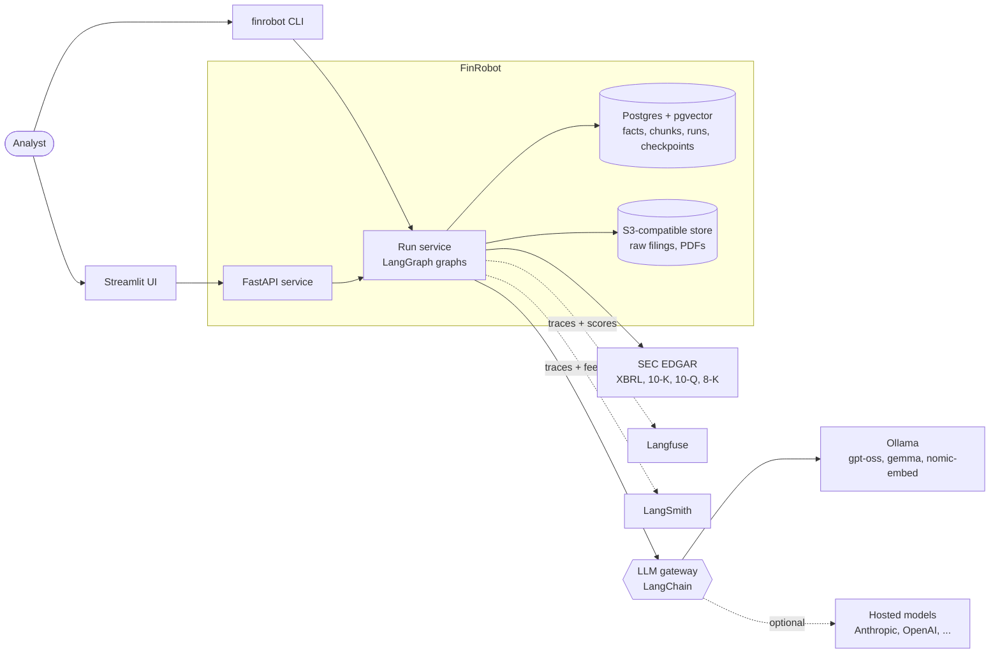
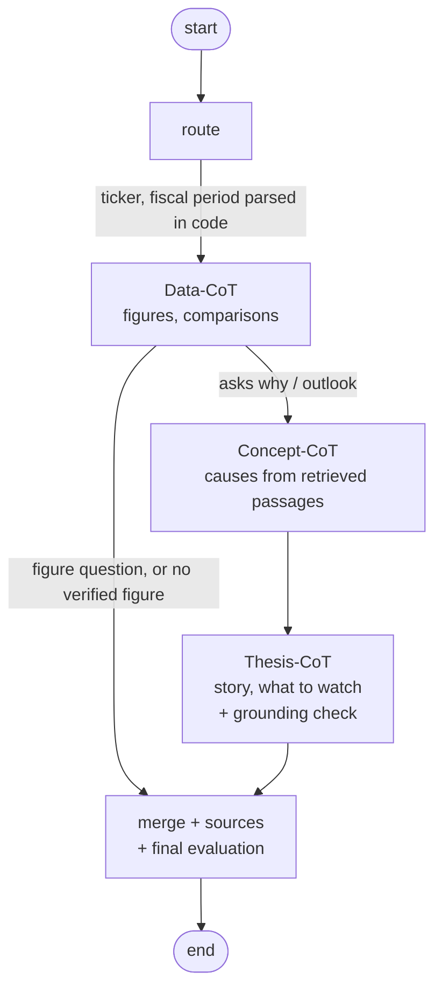
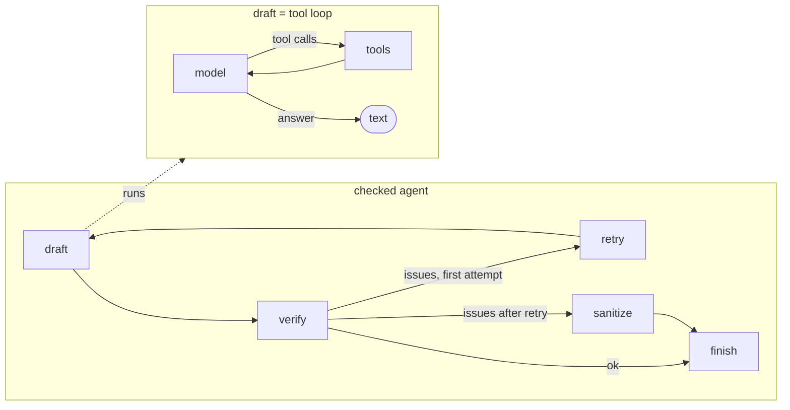
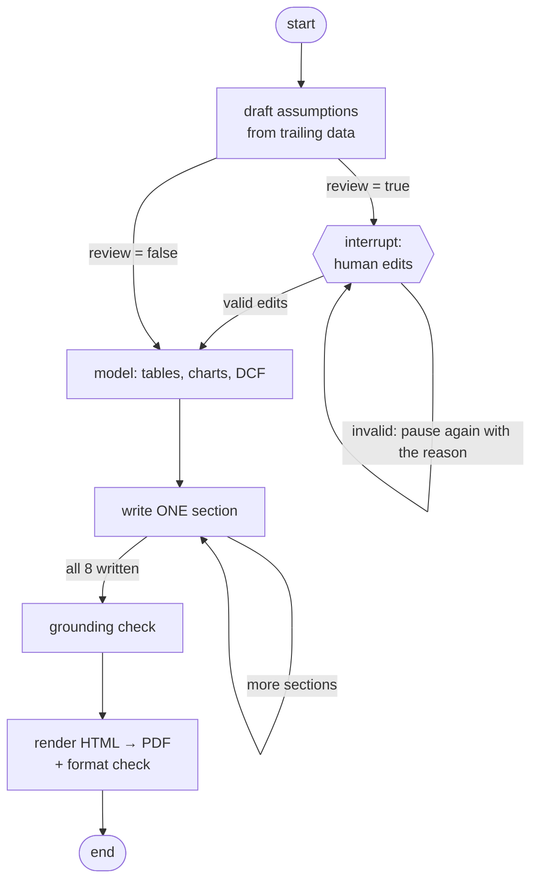
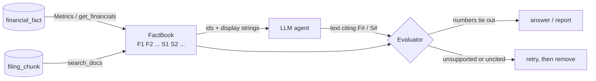
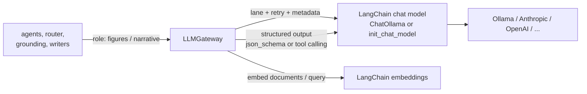
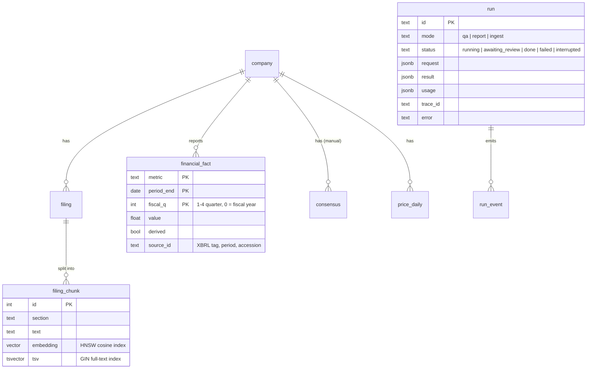
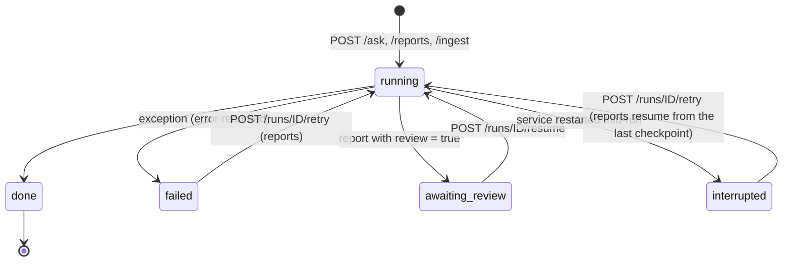
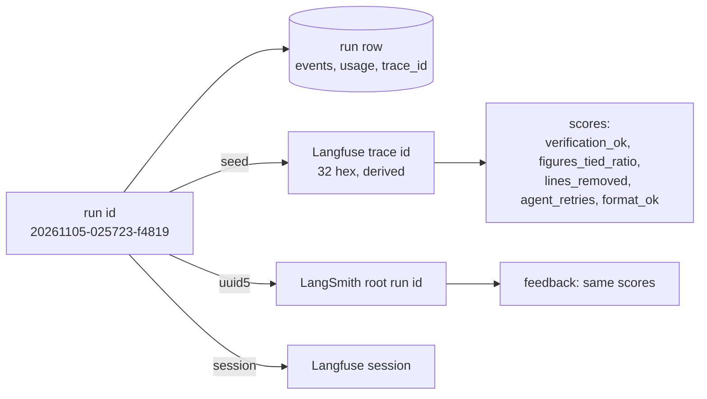

# Architecture

FinRobot answers analyst questions and writes equity research reports whose every figure can be traced to a filing line or a calculation.
This page describes the system as built in 0.2.0. The reasons behind the choices are in the [ADRs](adr/); the review of the whole design is
in the [System Design Review](sdr.md).

## 1. Design principle

> **The model reads and writes. Code does arithmetic, chooses periods, and checks every number.**

Everything below exists to make that sentence enforceable: a number can only reach a reader if it was *registered* (given an id by code),
*cited* by the model, and *verified* by a deterministic check. What cannot be verified is removed, not softened.

## 2. System context

## 3. Runtime components

| Component | Responsibility | Notes |
|---|---|---|
| `api/app.py` | HTTP surface, auth, validation, job queue, metrics | stateless; jobs return a run id at once |
| `service.py` | one place that executes a run: tracing, usage, scores, persistence, final status | shared by API and CLI |
| `graph/qa_graph.py` | question answering as a LangGraph | `Runtime` context carries the LLM gateway, event sink and `RunContext` |
| `graph/report_graph.py` | report generation as a checkpointed LangGraph | human review via `interrupt`, resume after a crash |
| `agents/react.py` | tool-calling loop as a subgraph | withholds tools on the last step, recovers malformed tool calls |
| `agents/checked.py` | generate → verify → repair as a subgraph | the guardrail loop |
| `llm/gateway.py` | the only place that talks to models | per-role model choice, retries, concurrency lane, structured output |
| `data/*` | EDGAR client, XBRL normaliser, parser/chunker, store, migrations, objects | Postgres access is pooled and transactional |
| `observability.py` | Langfuse + LangSmith wiring, scores, token usage | no-op without keys |

## 4. The graphs

### 4.1 Question answering

Each of the three agents is the same two-level subgraph:

* `verify` is the deterministic Evaluator: every unit-bearing number must equal a registered fact (within rounding) or appear in a cited
  passage; the periods a sentence names must be covered by the facts it cites; placeholder citations fail.
* `retry` puts the exact issues back into the prompt, once. `sanitize` deletes the lines that still fail. A draft about the wrong quarter
  becomes "no verified answer".
* The tool loop is a graph so each model call and tool call is its own span in Langfuse / LangSmith.

### 4.2 Report

State is small and serialisable (assumptions, prose, a FactBook snapshot). Heavy objects (tables, charts, the `RunContext`) live in the run's
`Runtime` context and are **rebuilt deterministically from the database** when a run resumes in a new process. Because the FactBook
deduplicates on `(label, value, unit, source)`, rebuilt facts get the ids the prose already cites. After every section a checkpoint is written
to Postgres; a crash costs at most one section of model calls.

## 5. The FactBook contract

| Id | Meaning | Created by |
|---|---|---|
| `F#` | a number: a reported XBRL fact, a derived metric (with its input ids), a calculation (expression kept), a price, a consensus value | `Metrics`, `calc`, report model |
| `S#` | a retrieved passage from a filing or earnings release | `search_docs` |

A fact carries a unit (`USD`, `%`, `pp`, `bps`, `x`, ...) and a **period basis** (`instant`, `q`, `ttm`, `fy`). `calc` infers the result's unit
and refuses combinations that silently mislead (a balance-sheet figure over one quarter's flow).

## 6. LLM gateway

* Roles map to models by `[provider:]model` strings (`gpt-oss:20b`, `anthropic:claude-sonnet-5-5`). Agents never import a provider SDK.
* One concurrency lane (`FINROBOT_LLM_CONCURRENCY`, default 1 for a single GPU slot); transient network errors retry with jittered backoff.
* Every call carries `role` and `model` metadata, which Langfuse and LangSmith show on the span and the usage tracker aggregates.
* Embedding dimensions are checked against the pgvector column before anything is written.

## 7. Data model

LangGraph's checkpoint tables (`checkpoints`, `checkpoint_blobs`, `checkpoint_writes`) live in the same database, keyed by `thread_id = run id`.
Retrieval is hybrid: pgvector cosine rank and Postgres full-text rank fused with reciprocal-rank fusion.

## 8. Run lifecycle

## 9. Observability join keys

Given a run id you can open its trace in either tool, and given a trace you can find the run row, its events and its artifacts. Details in
[observability.md](observability.md).

## 10. Failure behaviour

| Failure | Behaviour |
|---|---|
| Model returns an unverifiable figure | one retry with the issues, then the line is removed; a wrong-period answer becomes "no verified answer" |
| Provider emits a malformed tool call | nudged to retry inside the tool loop |
| Transient network error to the model | retried with jittered backoff (`FINROBOT_LLM_MAX_RETRIES`) |
| Ollama / hosted model down | run fails with the error recorded; `/ready` returns 503 |
| Postgres down at start | the API waits (up to 90 s) instead of crashing; `/ready` reports it afterwards |
| Object store down | local file fallback; reconnects after a 30 s cool-down; `/ready` shows `local-fallback` |
| Service restarts mid-run | run marked `interrupted`; reports resume from the last completed section |
| Invalid reviewer edit | the run pauses again with the reason; nothing is lost |
| Langfuse / LangSmith unreachable | tracing is best effort; runs are unaffected |
| Queue full | `429` with `Retry-After`; the rejected run is recorded as failed |
| Ingest interrupted | filing + chunks are one transaction; the next ingest picks up where it stopped |
