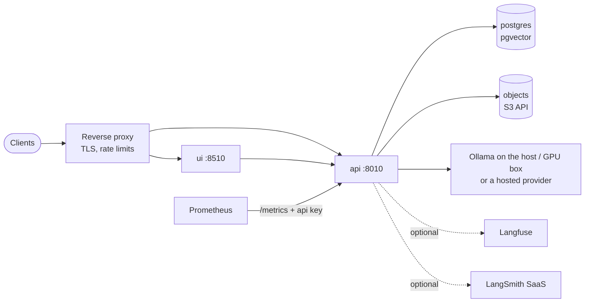

# Deployment runbook

Targets: a single host with Docker Compose (the supported path), or any container platform that can run one API replica, Postgres with pgvector and an
S3-compatible store. FinRobot 0.2.0 is **single-replica by design** ([ADR-0007](adr/0007-in-process-job-queue.md)).

## Topology



Requirements: Docker 24+ with Compose v2.20+, ~10 GB disk (models excluded), and a model server: Ollama with `gpt-oss:20b`, `gemma4:e4b`, `nomic-embed-text`
(≈ 24 GB of model files; a 16 GB GPU holds one chat model at a time) or hosted-provider keys.

## Configuration

Everything is environment variables (see `.env.example`). The ones that matter in production:

| Variable | Purpose | Notes |
|---|---|---|
| `FINROBOT_ENV` | `production` (image default) enables the startup gate | refuses empty/placeholder API keys, default S3/DB credentials, empty `SEC_USER_AGENT` |
| `FINROBOT_API_KEYS` | comma-separated keys accepted as `x-api-key` / bearer | `openssl rand -hex 24`; rotate by adding the new key, deploying, then removing the old |
| `SEC_USER_AGENT` | SEC EDGAR contact: `"FinRobot you@example.com"` | required by SEC fair-access rules |
| `DATABASE_URL` | Postgres with the `vector` extension | the image creates the extension on first migration (needs `CREATE EXTENSION` rights once) |
| `S3_ENDPOINT` `S3_ACCESS_KEY` `S3_SECRET_KEY` `S3_BUCKET` `S3_SECURE` | object store | any S3: set `S3_SECURE=true` for TLS endpoints |
| `OLLAMA_HOST`, `FINROBOT_MODEL_FIGURES`, `FINROBOT_MODEL_NARRATIVE`, `FINROBOT_EMBED_MODEL` | models; `provider:model` for hosted | changing the embedding model also needs `FINROBOT_EMBED_DIM` and a re-ingest |
| `FINROBOT_LLM_CONCURRENCY`, `FINROBOT_MAX_WORKERS`, `FINROBOT_MAX_QUEUE` | throughput | defaults 1 / 1 / 20 suit one GPU |
| `FINROBOT_LLM_TIMEOUT`, `FINROBOT_LLM_MAX_RETRIES` | model call timeout (s) and transient-error retries | defaults 600 / 3 |
| `LANGFUSE_*`, `LANGSMITH_*`, `FINROBOT_TRACE_INPUTS` | tracing | [observability.md](observability.md) |
| `FINROBOT_LOG_LEVEL`, `FINROBOT_LOG_JSON` | logging | JSON lines are the image default |
| `FINROBOT_CORS_ORIGINS` | comma-separated origins if a browser app calls the API directly | off by default |

## First deploy checklist

Several items below were **not exercised** in the development environment (no Docker daemon): do each once on the target and tick it off.

1. `cp .env.example .env`; set `SEC_USER_AGENT`; replace every `change-me-*`; set `FINROBOT_UI_API_KEY` to one of the API keys.
2. `docker compose config -q` resolves without errors.
3. `docker compose up -d --build`; `docker compose ps` shows `postgres`, `objects`, `api`, `ui` as healthy (the API waits for Postgres up to 90 s).
4. `docker compose logs api | head`: a line `finrobot 0.2.0 ready`, no `refusing to start` error.
5. `curl localhost:8010/health` → 200; `curl localhost:8010/ready` → 200 (503 names the failing dependency: Postgres, or a model not installed).
6. S3 auth: `docker compose exec api finrobot ping` reports `object store ok (s3)` (the SeaweedFS entrypoint writes the identity from `S3_ACCESS_KEY/SECRET`). If it reports the local fallback, see Troubleshooting.
7. `docker compose exec api finrobot ingest WM`, then ask a question from the UI or `POST /ask`; expect `status: done` and a populated `result.eval`.
8. A report: `POST /reports {"ticker":"WM","review":true}` → `awaiting_review` → `POST /runs/{id}/resume {}` → `done`; download the PDF from `/runs/{id}/artifacts/...`.
9. Tracing (if enabled): the run's trace appears in Langfuse/LangSmith with scores; see [observability.md](observability.md#verify-it-works).
10. Restart test: `docker compose restart api` during a report; the run shows `interrupted`; `POST /runs/{id}/retry` completes it.
11. Backup and restore rehearsal (below).

## Models

* **Host Ollama** (default): `ollama pull gpt-oss:20b gemma4:e4b nomic-embed-text` on the host; compose reaches it at `host.docker.internal:11434`.
* **Ollama in compose:** `docker compose --profile ollama up -d`, set `OLLAMA_HOST=http://ollama:11434`, then `docker compose exec ollama ollama pull ...` (needs the NVIDIA container toolkit).
* **Hosted:** `FINROBOT_MODEL_NARRATIVE=anthropic:claude-sonnet-5-5` plus `ANTHROPIC_API_KEY`; build with the extra (`uv sync --extra anthropic`; in the Dockerfile add `--extra anthropic` to the two `uv sync` lines).
  Raise `FINROBOT_LLM_CONCURRENCY` and `FINROBOT_MAX_WORKERS` only when the model is no longer a single GPU slot.

## Operating

| Task | How |
|---|---|
| Refresh a company | `finrobot ingest WM` (idempotent: only new filings are added; XBRL facts are replaced atomically). Schedule it after earnings season |
| Logs | `docker compose logs -f api` (JSON; filter by `run_id` or `request_id`) |
| Metrics | `GET /metrics` with the API key: `finrobot_runs_total`, `finrobot_run_seconds`, `finrobot_queue_depth`, `finrobot_http_*` |
| Stuck or crashed run | `GET /runs/{id}`; reports: `POST /runs/{id}/retry`; others: submit again |
| Rotate API keys | add new key to `FINROBOT_API_KEYS` → restart → move clients → remove old key → restart |
| Prices / consensus | `finrobot set-price`, `import-prices`, `fetch-prices`, `set-consensus` (CLI) or `POST /prices` |

Suggested alerts: run failure ratio > 10% (30 min); `verification_ok` pass rate < 85% (24 h, from Langfuse scores); `finrobot_queue_depth` ≥ 16 for 10 min; `/ready` failing 3 min.

## Upgrade and rollback

1. `git pull && docker compose build api ui` (or pull the tagged image).
2. `docker compose up -d`: the new API applies pending migrations on start (advisory-locked, additive, idempotent) before reporting ready.
3. In-flight runs become `interrupted`; resume reports with `/retry`.
4. **Rollback:** redeploy the previous image tag. Migrations only add objects, so the previous version keeps working. (If a future migration is destructive it will be flagged in the changelog and the ADRs.)

## Backup and restore

```bash
# Postgres: facts, runs, events, LangGraph checkpoints
docker compose exec -T postgres pg_dump -U finrobot -Fc finrobot > finrobot-$(date +%F).dump
# restore into an empty database
docker compose exec -T postgres pg_restore -U finrobot -d finrobot --clean --if-exists < finrobot-YYYY-MM-DD.dump
# files: the `appdata` volume (PDFs, charts, EDGAR cache) and the `objdata` volume (raw filings)
docker run --rm -v finrobot_appdata:/d -v "$PWD":/b alpine tar czf /b/appdata.tgz -C /d .
```

Filings and facts are re-creatable from EDGAR (`finrobot ingest`), so back up `run`, `run_event` and checkpoint tables first. Test a restore at least once.

## TLS and exposure

Put a reverse proxy in front; do not publish the API directly. Example (Caddy):

```
finrobot.example.com {
    reverse_proxy /api/* api:8010
    reverse_proxy ui:8510
}
```

Compose binds every published port to `127.0.0.1` by default (`API_BIND`, `UI_BIND` override). The UI uses its own API key; give end users the proxy, not the key.

## Kubernetes notes

Run **one** API pod (`replicas: 1`, `strategy: Recreate`); liveness `GET /health`, readiness `GET /ready`; a PVC for `/data`; Postgres via a managed service with `pgvector`; secrets from
the cluster secret store; `terminationGracePeriodSeconds: 40` (matches the compose grace period, and in-flight work is resumable anyway). A second replica needs a shared
queue first ([ADR-0007](adr/0007-in-process-job-queue.md)).

## Troubleshooting

| Symptom | Likely cause | Fix |
|---|---|---|
| API exits: `refusing to start in production: ...` | placeholder or default secret | set real values; the message lists which |
| `/ready` 503, `postgres: false` | database unreachable or still starting | check `DATABASE_URL`, `docker compose ps postgres` |
| `/ready` 503, a model `NOT INSTALLED` | model not pulled | `ollama pull <model>` |
| Run `failed`: `Ollama request failed` / connection refused | model server unreachable from the container | `OLLAMA_HOST`; on Linux the `host-gateway` mapping is already in compose |
| Run `failed`: embedding dimension mismatch | embedding model changed | set `FINROBOT_EMBED_DIM`, run a migration for the column, re-ingest |
| `object store: local-fallback` | S3 unreachable or credentials differ between `objects` and `api` | same `S3_ACCESS_KEY`/`S3_SECRET_KEY` for both; `S3_ENDPOINT=objects:8333` |
| Many `No verified answer` | model not following tool protocol | check `lines_removed`/`agent_retries` scores; try a larger or hosted `figures` model; run `evals/` |
| PDF render error about fonts/Pango | missing system libraries (custom image) | install `libpango-1.0-0 libpangoft2-1.0-0 libharfbuzz0b fonts-dejavu-core` |
| `429` from the API | queue full | wait (`Retry-After`), or raise `FINROBOT_MAX_QUEUE` |
