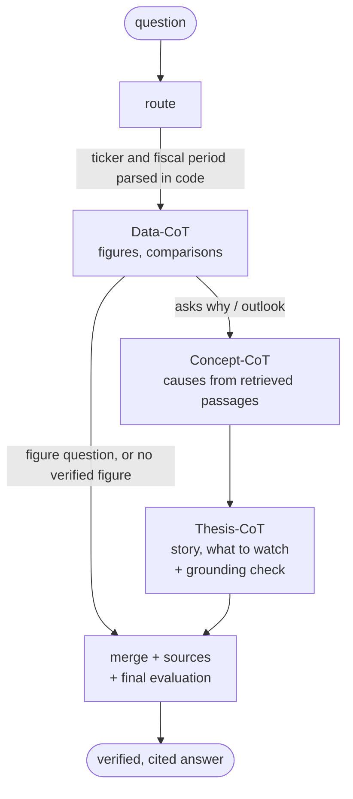

# FinRobot

Multi-agent equity research with **verified, cited figures**. Give it a ticker: it ingests SEC filings and XBRL financials, answers analyst
questions ("why did EBITDA move?") with every number tied to a source, and writes an 8-section equity research PDF with tables, charts, a DCF and a
verification appendix.

[:fontawesome-brands-github: Source code on GitHub](https://github.com/sadiqgpasha89/FinRobot){ .md-button .md-button--primary }
[Architecture](architecture.md){ .md-button }
[System Design Review](sdr.md){ .md-button }

> **The model reads and writes. Code does arithmetic, chooses periods, and checks every number.**

## What is inside

| Piece | Role |
|---|---|
| **LangGraph** | the question and report workflows, the tool loop and the verify → retry → sanitize loop as subgraphs; durable report runs with human review of the valuation assumptions |
| **LangChain** | one `LLMGateway` for chat and embedding models, chosen per role (`figures`, `narrative`); local Ollama by default, hosted providers by configuration |
| **Langfuse** | production traces (one per run, the run id as the session) and per-run quality scores such as `verification_ok` and `figures_tied_ratio` |
| **LangSmith** | automatic tracing, the same scores as feedback, and golden-set experiments |
| **Postgres + pgvector** | facts, filing chunks (hybrid search), run records and graph checkpoints |

## How a question is answered

Every agent is the same loop: a tool-calling draft, a deterministic check that each number ties to a registered fact or a cited passage, one repair
attempt with the exact issues, then deletion of whatever still cannot be verified.

## Where to start

* **Understand the design:** [Architecture](architecture.md), then the [System Design Review](sdr.md); the reasons behind each choice are in the
  [decision records](adr/README.md).
* **Run it:** quick starts for Docker and for local development are in the
  [README on GitHub](https://github.com/sadiqgpasha89/FinRobot#quick-start-docker); production steps are in the [deployment runbook](deployment.md).
* **Operate it:** [Observability](observability.md) covers Langfuse, LangSmith, scores and privacy; [Development](development.md) covers tests and how to extend it.
* **See what changed in 0.2.0:** the [audit](audit-0.2.0.md) lists the 40 bugs and gaps found, with the fix and regression test for each, and the
  [Medium article](medium/finrobot-medium-article.md) tells the story.

!!! note "Not financial advice"
    FinRobot produces research aids from public filings under stated assumptions. It makes no recommendation to buy or sell any security.
