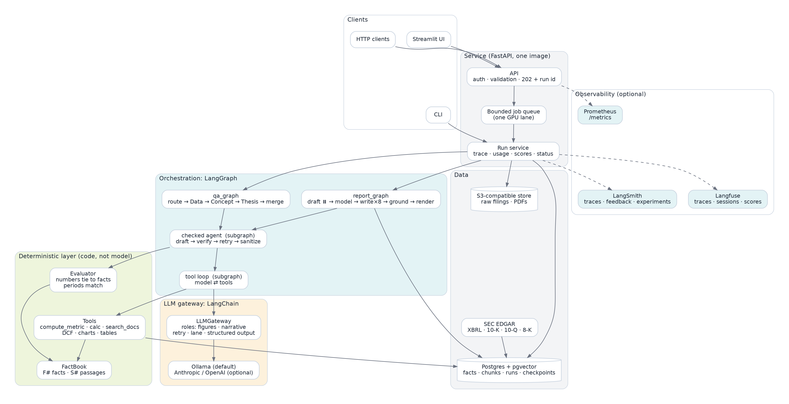
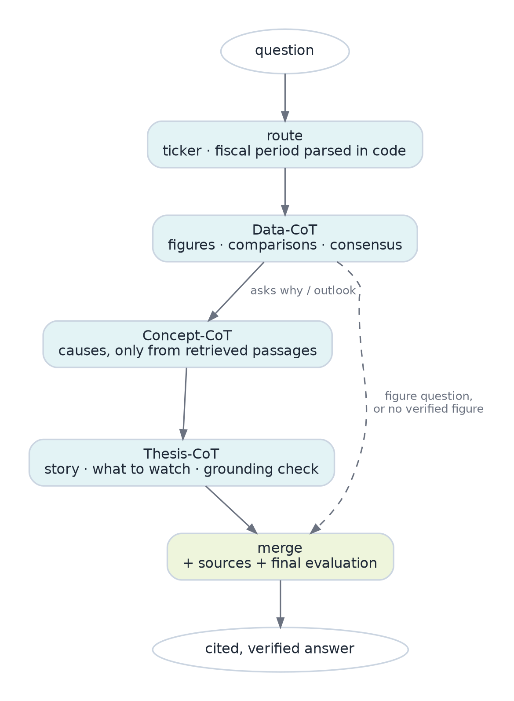
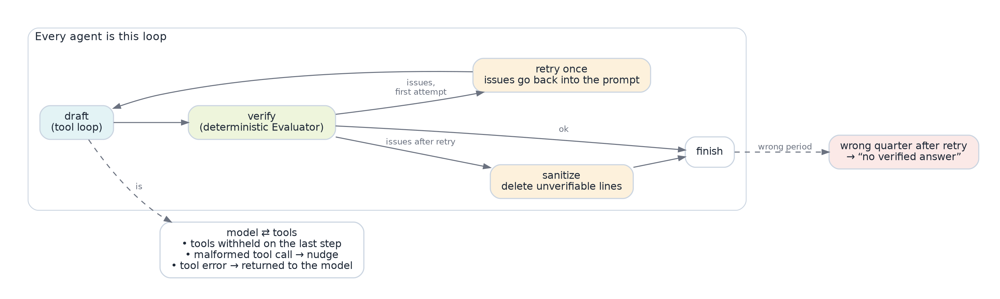
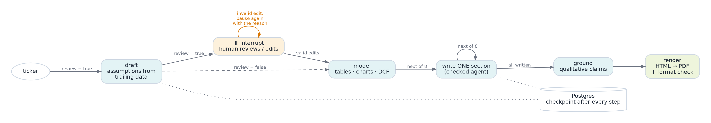
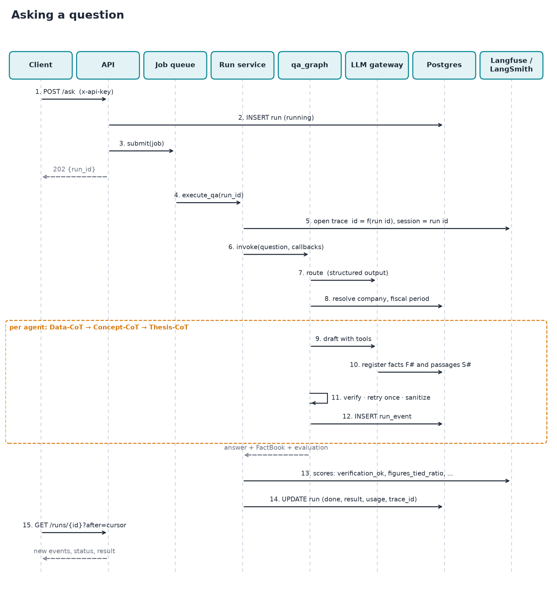
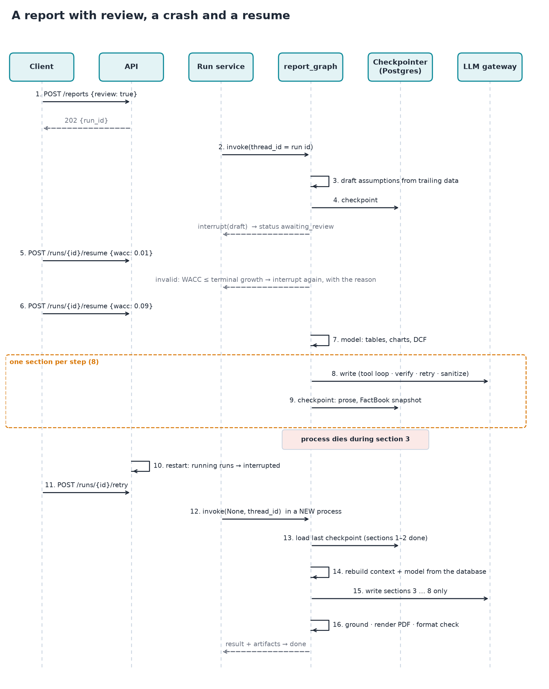
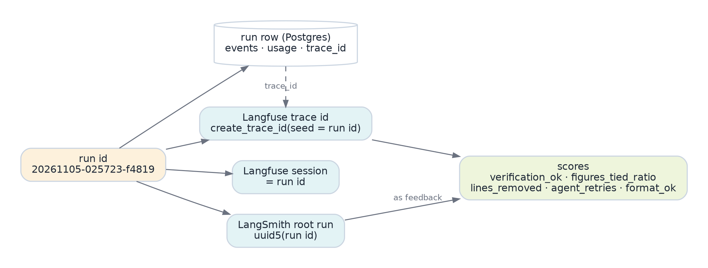

# Making an LLM Unable to Lie About Numbers

### Taking a multi-agent equity-research system from demo to production with LangGraph, LangChain, Langfuse and LangSmith: the problem solutioning, the architecture, the sequence diagrams, and the decisions (ADRs) behind it

*Reading time: ~14 minutes. Code: the FinRobot repository (`docs/` holds the ADRs and the System Design Review this article summarises).*

> **Publishing notes (delete before posting):** Medium does not render Mermaid or tables well, so every diagram here is a PNG in `images/` (rebuild with `python docs/medium/build_diagrams.py`); the two tables are best pasted as images or turned into lists. Add the repository link where marked.

---

## 1. The problem: fluent, confident, wrong

Ask an LLM "why did EBITDA move last quarter?" and you get a beautiful paragraph. Ask a finance professional to rely on it, and the first wrong number ends the conversation.

I started with a prototype that worked: ingest SEC filings, route a question to three specialist agents (Data, Concept, Thesis), merge the answers, and write an 8-section equity research PDF. It ran on local models, and it demoed well. Then I ran it against real filings and kept a log of what went wrong. Every item below was *a real figure or a real document*, and every one was wrong in a way a reader could not see:

| What the model did | Why it is dangerous |
|---|---|
| Rewrote "Q3 versus a year ago" as "Q3 2024" and answered about 2024 | the numbers are real, the period is not the one asked about |
| Called a 3.4-percentage-point margin move "3 bps" | the unit changes the meaning by 100× |
| Typed numbers into a calculation by hand after a rejected call | a figure with no provenance |
| Labelled a real $2.07B figure "FY2024 Q3" when it was FY2026 Q3 | passes a "does this number exist?" check |
| Divided net debt by **one quarter's** EBITDA: 11.0x instead of 2.93x | every input was real and cited |

The last one is the instructive one. Nothing was invented. A checker that asks "is this number in the source?" says yes. The answer is still wrong by 4×.

So the real problem is not "reduce hallucinations". It is: **how do you build a system in which a wrong number cannot reach the reader, even though a language model is in the loop?**

## 2. Problem solutioning: how I got to the design

I did not start with an architecture. I started with the failures and asked what *class* each belonged to.

**Step 1: classify the failures.** Wrong period, wrong unit, wrong arithmetic, wrong basis (quarter vs trailing twelve months), no provenance. None of these is about knowledge. They are about **bookkeeping the model is bad at**: which period, which unit, which operation.

**Step 2: take the bookkeeping away from the model.** If the model cannot choose a period, it cannot choose the wrong one: periods are parsed from the question *in code*, and tools take `quarters_ago`, never a year. If it cannot do arithmetic, it cannot get arithmetic wrong: all computation is a tool, and the tool *infers* the unit from the operands instead of trusting a label. If it cannot type a number, it cannot make one up: every figure the model may mention is **registered** by code under an id (`F12`), and a calculation may only use registered ids.

**Step 3: assume the model will still misbehave, and make that visible.** A deterministic **Evaluator** reads the finished prose and ties every number carrying a unit to a registered fact (within rounding) or to a cited passage; it checks that the periods a sentence names are covered by the facts it cites. This is the piece that catches "FY2024 Q3: $2.07B", and a period-basis check inside `calc` is what catches 11.0x.

**Step 4: fail closed.** When verification fails, the draft gets *one* repair attempt with the exact issues in the prompt. If lines still fail, they are **deleted**, not softened. If the answer is about the wrong quarter, the output is "no verified answer". I would rather ship silence than a confident error.

This is the whole idea, in one sentence that became the design principle:

> **The model reads and writes. Code does arithmetic, chooses periods, and checks every number.**

That prototype existed before this article. The work I want to describe is what it took to make it *production-grade*: to make the loop above first-class in an orchestration framework, observable, durable, secure and deployable.

## 3. The architecture



Reading it top to bottom: clients hit a FastAPI service that authenticates, validates, queues and returns a run id immediately. A run service executes the job inside LangGraph, with tracing, token accounting and quality scores wrapped around it. Orchestration is two graphs (question answering and report generation) built from the same two subgraphs. Below them sits the deterministic layer (the FactBook, the tools, the Evaluator), which is where the principle is enforced. All model access goes through one LangChain-based gateway. State lives in Postgres with pgvector; Langfuse and LangSmith are optional.

Two properties matter more than any box:

1. **The Evaluator is not an agent.** It is code, and there is no path from a model to a reader that skips it.
2. **Models are replaceable; verification is not.** Swapping the narrative model for a hosted one changes an environment variable. The numbers a reader sees still passed the same checks.

## 4. LangGraph: control flow as a graph

The prototype used LangGraph for a straight line of five functions and hand-wrote everything interesting: a `while` loop for tool calls, a retry function for verification, a dictionary smuggling the run context between nodes. Those hand-written pieces are exactly the control flow that matters, and exactly the parts that were invisible to tracing and impossible to checkpoint.

### The question graph



`route` extracts the ticker and parses the fiscal period in code. `Data-CoT` establishes the figures. Only if the question asks *why* do `Concept-CoT` (causes, strictly from retrieved passages) and `Thesis-CoT` (story, what to watch, plus a grounding check) run; a figure question short-circuits to `merge`. This is a conditional edge: `after_data` returns `"merge"` or `"concept"`.

Run-scoped things (the LLM gateway, the event sink, the `RunContext` holding the FactBook) travel in LangGraph's typed `Runtime` context instead of the state:

```python
@dataclass
class QARuntime:
    llm: LLMGateway
    ticker: str | None
    emit: Callable[[dict], None]
    ctx: RunContext | None = None

def n_data(state: QAState, runtime: Runtime[QARuntime]) -> QAState:
    return {"data": data_cot(runtime.context.ctx, state["route"]["data_question"])}

graph = StateGraph(QAState, context_schema=QARuntime)
```

### Every agent is the same loop



Each of the three agents is a *subgraph*: `draft` (itself a model ⇄ tools subgraph), then `verify`, then one of `finish`, `retry` or `sanitize`.

```python
g.add_conditional_edges("verify", after_verify,
                        {"retry": "retry", "sanitize": "sanitize", "finish": "finish"})
g.add_edge("retry", "draft")        # once: the exact issues are appended to the prompt
```

Making this a graph instead of a function was not stylistic. In Langfuse and LangSmith, every attempt, every verdict and every repair is its own span. When a user gets "no verified answer", I can open the trace and see *which claim failed verification, on which attempt*. Before, that was a log search.

Small, hard-won behaviours live in the tool-loop subgraph, each added after a real failure: on the last permitted step the tools are **withheld** and the model is told to answer (a model still mid-loop otherwise returns nothing); a provider's "malformed tool call JSON" error becomes a nudge to try again instead of a crash; a tool that raises returns its error to the model so it can adjust. Both subgraphs compile with `checkpointer=False`, so their non-serialisable state is never persisted even inside a checkpointed parent.

### The report graph: durable by design



A report is minutes of model work across eight sections. The prototype lost all of it on a crash, and "let the analyst edit the valuation assumptions" was a UI convention, not part of the workflow. In 0.2.0 it is part of the graph:

* **One section per graph step**, so every section is a checkpoint (Postgres, `thread_id = run id`).
* **`interrupt()` for human review.** With `review=true` the run pauses after drafting assumptions from trailing data and hands the draft to the caller.
* **State is small and serialisable** (assumptions, prose, a FactBook snapshot). The heavy objects (tables, charts, the context) live in the `Runtime` and are **rebuilt deterministically from the database** after a resume in a new process. This works because the FactBook de-duplicates facts on `(label, value, unit, source)`: rebuilt facts get the same ids the prose already cites.

An integration test found the subtle part. My first version validated the reviewer's edits inside the node and *raised* on a bad value. It looked right and was unrecoverable: LangGraph keeps the failed resume value for that task, so every later resume replayed the same bad edit and the run could never continue. The fix is the documented pattern: validate in a loop that **re-interrupts with the reason**.

```python
edits = interrupt(payload)
while True:
    try:
        a = apply_overrides(Assumptions.from_dict(draft), edits or {})
        break
    except ValueError as e:
        edits = interrupt({**payload, "error": str(e)})   # ask again, do not raise
```

### The sequence of a question



The client gets `202 {run_id}` before any model runs (the run row is written first, so polling works immediately), and polls `GET /runs/{id}?after=<cursor>` for new events. Events are rows, not a growing JSON blob, so a long run does not rewrite its entire history on every step.

### The sequence of a report, including a crash



The integration test for this exact scenario kills the first run at its third model call, builds a *new* gateway (a new process), and resumes: the second run makes exactly the remaining six of eight model calls, and the two finished sections are not paid for again.

## 5. LangChain: one gateway, models by role

The prototype spoke to Ollama over raw HTTP. Tool calling, structured output, retries and embeddings were each hand-rolled. I moved all of it to LangChain and put it behind one class, `LLMGateway`, the only code that touches a model:

* Agents ask for a **role**: `figures` (routing, numbers, fact-checks) or `narrative` (prose). Settings map a role to a `[provider:]model` string: `gpt-oss:20b` is Ollama; `anthropic:claude-sonnet-5-5` is hosted. Moving a role to another provider is an environment variable.
* The gateway owns the **concurrency lane** (one GPU slot by default), **jittered retries on transient network errors only**, per-call `role`/`model` metadata (which shows up on the span), **structured output** (provider-side schema decoding on Ollama, tool calling elsewhere, JSON-from-text as a last resort) and an **embedding-dimension check** against the pgvector column.
* `Tool` stays a tiny dataclass (name, JSON schema, function) and converts to a LangChain `StructuredTool` at the edge, so tools remain plain Python and each call becomes a tool span.

Tests use a scripted chat model injected through `chat_factory`: replies come from a script (strings, tool calls, exceptions, or functions of the conversation), so 170+ tests need no GPU.

The honest lesson here is about fakes. They cannot catch a provider contract drifting. The first live run against real Ollama models found two bugs every fake-based test had passed: `OllamaEmbeddings(keep_alive="10m")` was rejected by the real constructor (it takes an integer of seconds, so *every ingest would have failed*), and gpt-oss silently omitted the router's `company` field because my pydantic schema had defaults and therefore no `required` list. Both now have regression tests, and a live smoke run is part of the release routine.

## 6. Observability: Langfuse for production, LangSmith for development

Two different questions need two different tools.

* **In production:** what did this run do, what did it cost, did its verification pass, and is quality trending? That is **Langfuse**: self-hostable (important when traces contain company data), one trace per run, with **scores**.
* **In development:** did this prompt, tool or model change make the golden set better or worse? That is **LangSmith**: native LangGraph traces, datasets and experiments.

Both are optional and inert without keys. They are joined by the run id:



```python
trace_id = langfuse.create_trace_id(seed=run_id)            # derivable from the run id, stored on the run row
with langfuse.start_as_current_observation(name="finrobot.qa.request", as_type="chain",
                                           trace_context={"trace_id": trace_id}):
    with propagate_attributes(session_id=run_id, trace_name="finrobot.qa", tags=[...]):
        config["callbacks"].append(CallbackHandler())        # nested spans for every node, model and tool call
        graph.invoke(state, config)
```

The best part of observability for an LLM system is **scores that mean something**. Verification outcomes become scores on the trace: `verification_ok`, `figures_tied_ratio` (share of numbers matched to a fact or a passage), `lines_removed`, `agent_retries`, `format_ok`. "Verification pass rate by day" is a dashboard, not a grep.

Three more details that matter in practice. A small `UsageTracker` callback records tokens, calls and latency per role into the run row regardless of either backend (a full live question: 11 model calls, 14.7k input and 1.2k output tokens). `FINROBOT_TRACE_INPUTS=false` redacts prompts and outputs before they leave the process; scores and timings still flow. And I verified the Langfuse integration without a server by running the *real* SDK against an in-memory span exporter and asserting one trace per run, the session id, and that model calls nest under the run's root. (Delivery to a live Langfuse or LangSmith project I did not verify; it is on the first-deploy checklist.)

## 7. Production hardening: what a careful read found

I read the whole prototype (about 4.7k lines) as if I were about to be paged for it. 40 findings are logged in `docs/audit-0.2.0.md`, each with a fix and a regression test. A few that changed how I think about LLM systems:

**Model text is untrusted input.** The report pipeline took model and filing text through Markdown into HTML that was both served and rendered to PDF. That is markup injection, and the PDF renderer would fetch any URL it found: a server-side request forgery from a document generator. Fixes: escape before Markdown; table cells are always escaped (a cell that merely *started with* `<` used to bypass escaping); the renderer's URL fetcher allows only `data:`; served HTML gets a restrictive CSP. A test starts a local HTTP server and proves the render makes **zero** requests.

**Data integrity bugs hide in "obvious" code.** A filing row and its chunks were written in separate autocommits, so an embedding failure left a filing with no chunks, and the "already ingested?" check then skipped it forever. A facts refresh was `DELETE` then `INSERT`, so a failed insert left a company with no facts. A blank company from the router became `ILIKE '%%'` and silently analysed *an arbitrary company*. All fixed with transactions and a stricter lookup, all proven against a real Postgres.

**"Works on my machine" packaging.** Template and output paths were computed relative to the source checkout, so a wheel or container install could not find its own templates. I built the wheel, installed it into a clean venv and rendered a PDF from an unrelated directory to prove the fix.

**Fail fast.** When the object store was down, the default client took about six seconds to give up, longer than a readiness probe. Now 0.35 s, with a cool-down so it reconnects later instead of failing forever.

## 8. Deployment

One image runs the API, the UI and the CLI (`finrobot serve | ui | ingest`): multi-stage build from the lockfile, non-root user, tini, a health check, WeasyPrint's system libraries. Compose runs Postgres (pgvector), an S3-compatible store with authentication, the API and the UI, with secrets **required** (compose refuses to start without them), ports bound to localhost, no-new-privileges, dropped capabilities and a read-only root filesystem for the API. Optional files add a local Ollama (profile) and a self-hosted Langfuse stack. CI runs lint, unit tests, integration tests against a real `pgvector` service container with an 80% coverage gate, and a Docker build with smoke tests.

Production has a startup gate: `FINROBOT_ENV=production` **refuses to start** with empty or placeholder API keys, default storage credentials or no SEC user agent. The service exposes `/health` (liveness), `/ready` (Postgres and models), Prometheus `/metrics`, JSON logs with run and request ids, a bounded job queue (`429` with `Retry-After` when full), and on restart marks interrupted runs so reports can be resumed.

## 9. The decisions, as ADRs, and the review, as an SDR

Decisions that need a reason a year later go in Architecture Decision Records. The nine for this release, in one line each:

1. **LangGraph at every level**, not just the top: loops, verification and review are graph control flow, so they are traceable and checkpointable.
2. **Numbers are registered, cited and verified by code**; the model never does arithmetic. Silence beats a confident error.
3. **LangChain behind one `LLMGateway`**, models by role: provider changes are configuration; fakes make tests GPU-free.
4. **Postgres + pgvector for everything** (facts, chunks, runs, checkpoints): one backup, one failure domain, transactional ingest.
5. **Langfuse for production, LangSmith for development**, optional, joined by run id.
6. **Durable reports:** small serialisable state, rebuildable runtime context, `interrupt` for review.
7. **An in-process bounded queue**, because one GPU makes parallel runs pointless. The ADR names the trigger to revisit: a shared queue is needed before a second replica.
8. **Security posture:** escape untrusted text, isolate the renderer, key-protected API, production refuses defaults.
9. **Local models first**, hosted by configuration.

The ADR format forces the part people skip: alternatives considered and *what the decision costs*. ADR-0007's honest consequence is that the system is single-replica; ADR-0005's is that delivery to live vendors is not yet verified in CI.

The **System Design Review** (here, SDR = System Design Review) assembles it for a reviewer: requirements with measurable targets, the key flows as sequence diagrams, a failure-mode table (14 failure modes, each with detection and recovery), a STRIDE-style security review with residual risks, observability and SLOs, capacity, deployment and rollback, and a review checklist. The most useful section is the one I almost left out: a **verification status** table that separates what was *run* from what was *only written*.

## 10. How I know it works, and what I did not verify

* **174 tests, 87% combined coverage.** Unit tests need no GPU, network or database. Integration tests use a real Postgres 16 with pgvector, the real LangGraph Postgres checkpointer, a mock SEC server and a scripted model, and run both graphs end to end, including human review and crash-then-resume.
* **A live run on real models** (gpt-oss:20b and gemma4:e4b via Ollama on a 16 GB laptop GPU, over a seeded company): a full question to a verified answer in 32 seconds, 12 of 12 figures tied to database rows, one of them recomputed independently by hand. The figures-only path verified in 5 of 6 repeated runs; the sixth returned "no verified answer", consistent with the roughly one-in-eight rate the project documents. That is the intended trade.
* **Integration tests found defects that unit tests missed** (a list-vs-count type error in score computation; the unrecoverable review loop), and the live runs found two more (the embeddings constructor; the optional schema fields). The test pyramid is not a ritual: each layer found things the one below it could not.

What I could **not** verify here, stated plainly: building and running the Docker image (no Docker daemon in my environment; CI builds and smoke-tests it), a live Langfuse/LangSmith project (no credentials), the self-hosted Langfuse stack, and an ingest of a real company from EDGAR (the SEC requires an operator-supplied contact in the User-Agent; the client is tested against a mock SEC). Each is on a first-deploy checklist rather than glossed over.

## 11. What I would do next

* **A shared queue** (and the ADR-0007 trigger) when a hosted model removes the GPU constraint.
* **Move the `figures` role to a hosted model** and measure the verified-answer rate with the LangSmith experiments; it is the cheapest lever on the "no verified answer" rate.
* **Quote-level grounding** for qualitative claims. Numbers are checked deterministically; wording like "reinforces a resilient position" is still checked by a model, and that is the remaining soft spot.
* **Per-user identity** and rate limits in front of the API; dependency scanning in CI.

## Takeaways

1. **Classify failures before designing.** "Hallucination" was five different bookkeeping errors; each had a mechanical fix.
2. **Take decisions away from the model and make the rest checkable.** Registered facts, tool arithmetic, code-parsed periods, a deterministic evaluator.
3. **Fail closed.** One repair attempt, then delete. Silence is a feature.
4. **Make the control flow a graph.** Loops, verification and review become traceable, checkpointable and testable.
5. **Treat model output as untrusted input**, including in your document generator.
6. **Fakes are necessary and insufficient.** Run the real stack: real Postgres, real models. They find a different class of bug.
7. **Write down what you did not verify.**

*Code and docs: `<link to the FinRobot repository>`. Questions and corrections welcome.*
