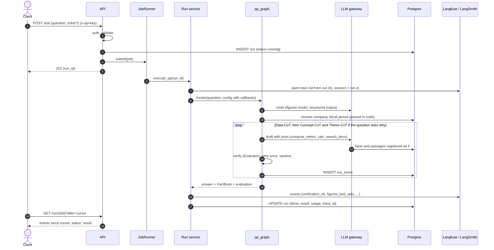
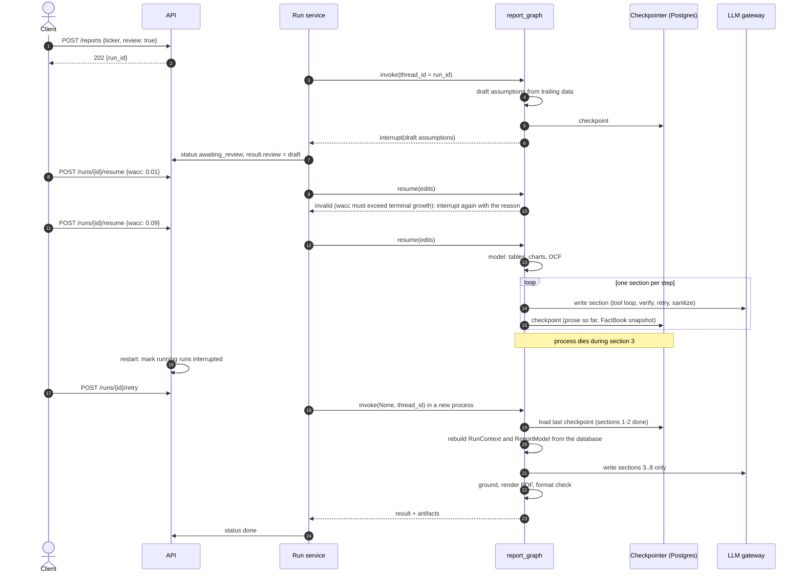
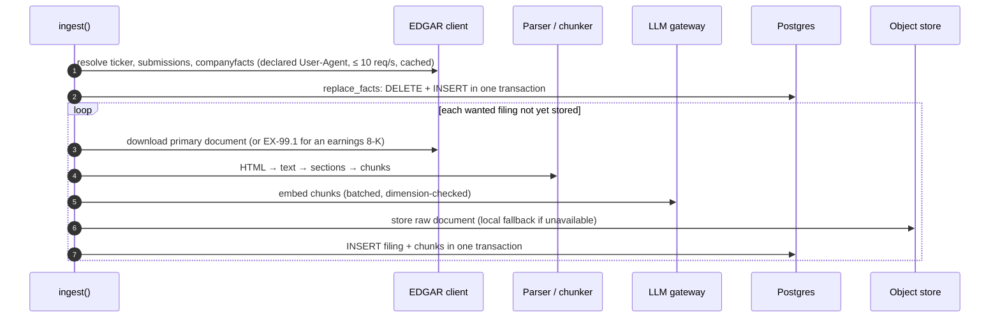

# System Design Review — FinRobot 0.2.0

> **SDR** is used here to mean *System Design Review*: the single document a reviewer reads to decide whether the design is fit to deploy. The
> reasoning behind individual choices is in the [ADRs](adr/); the structure is in [architecture.md](architecture.md); operating it is in
> [deployment.md](deployment.md).

| | |
|---|---|
| Subject | FinRobot: multi-agent equity research with verified, cited figures |
| Version | 0.2.0 (MVP, production-hardened) |
| Review date | 2026-11-05 |
| Status | Ready for a **single-replica** production deployment; scale-out, multi-tenancy and live-vendor integrations listed under *Open items* |
| Sign-off | Engineering ☐ · Security ☐ · Operations ☐ · Data/Model owner ☐ |

## 1. Problem statement

Analysts spend hours turning filings into answers ("why did EBITDA move?") and reports. LLMs can draft both, but they state wrong numbers fluently:
the failures found while building 0.1 were a model inventing a fiscal year, calling a 3.4-point margin move "3 bps", labelling a real figure with the
wrong quarter, and dividing net debt by one quarter of EBITDA (11.0x instead of 2.93x), with every input real and cited. A system that is right 95%
of the time with no way to know which 5% is not usable for finance.

## 2. Goals and non-goals

**Goals**
1. Question mode: answer analyst questions about a US-listed company with **every number tied to a source** and every period checked.
2. Report mode: produce an 8-section equity research PDF (tables, charts, DCF, verification appendix) from public filings.
3. Make unverifiable content *absent* rather than flagged: fail closed.
4. Run on a single 16 GB GPU with local models; allow hosted models per role by configuration.
5. Be operable: traced, scored, resumable, observable, deployable from one image.

**Non-goals**
Real-time trading signals, order execution, portfolio management, personalised advice, non-US filers, multi-tenant SaaS, horizontal scale-out (0.2.0).

## 3. Requirements

### 3.1 Functional
| ID | Requirement | Where |
|---|---|---|
| F1 | Ingest a company: XBRL facts, 10-K, 10-Q, earnings 8-K, chunked and embedded | `data/ingest.py` |
| F2 | Answer a question via Router → Data-CoT → Concept-CoT → Thesis-CoT, cited | `graph/qa_graph.py` |
| F3 | Generate a report with a DCF whose assumptions can be reviewed and edited | `graph/report_graph.py` |
| F4 | Resume a report after human review or a crash without redoing finished sections | checkpointer, `/resume`, `/retry` |
| F5 | HTTP API with background jobs; CLI; UI | `api/`, `cli.py`, `ui/` |
| F6 | Every run is recorded: events, result, token usage, trace id, artifacts | `runs.py`, `store.py` |

### 3.2 Non-functional (targets, with how each is evidenced)
| Quality | Target | Evidence |
|---|---|---|
| Numeric integrity | 0 unverified unit-bearing numbers in published prose | deterministic Evaluator; 12/12 figures tied in a live run; regression tests per past failure |
| Availability of answers | ≥ 85% of simple figure questions return a verified answer | live check: 5 of 6 (Data-CoT, gpt-oss:20b); measure with `evals/` |
| Latency | question ≤ 60 s, report ≤ 10 min on the reference GPU | live: full question 32 s; model time dominates |
| Durability | a crash loses at most one report section | integration test: resume makes exactly the remaining 6 of 8 model calls |
| Security | no unauthenticated access in production; no markup or request injection from model text | `tests/test_security.py`, `tests/test_api.py`, production gate |
| Privacy | no content leaves the host unless tracing is enabled; redaction available | `FINROBOT_TRACE_INPUTS`, tracing opt-in |
| Observability | a run id leads to its trace, scores, events and artifacts | [observability.md](observability.md) |
| Maintainability | unit tests need no GPU, network or DB; ≥ 80% combined coverage in CI | 174 tests, 87% combined |
| Portability | one image runs API, UI and CLI; any S3 and any Postgres+pgvector | `Dockerfile`, compose |

## 4. Solution overview

Two LangGraph graphs (question answering, report generation) over a shared tool layer and a Postgres store. Every agent is a *tool loop* followed by a
*deterministic verification loop*. All model access goes through one LangChain-based gateway. Runs are traced to Langfuse and/or LangSmith and scored on
verification outcomes. See [architecture.md](architecture.md) for diagrams and the [ADR index](adr/README.md).

## 5. Key flows

### 5.1 Ask a question

### 5.2 Report with review, a crash and a resume

### 5.3 Ingest

## 6. API design

REST, JSON, one resource family (`runs`). Writes that take time return `202` with a run id; reads are cheap and cursor-based
(`GET /runs/{id}?after=<event id>`). Error model: `401` missing/invalid key, `404` unknown company or run, `409` wrong run state, `422` invalid input (before any
work), `429` queue full (+ `Retry-After`), `503` from `/ready` when a dependency is down. Every response carries `x-request-id`. The full endpoint list is in the
[README](../README.md#api); OpenAPI is served at `/docs`.

## 7. Data design

See the ER diagram in [architecture.md §7](architecture.md#7-data-model). Notable properties: facts are keyed by `(ticker, metric, period_end, fiscal_q)` with
`fiscal_q = 0` meaning a fiscal-year flow; derived rows (Q4 = FY − 9M, cash-flow quarters) are flagged; `run_event` rows replace an append-only `jsonb`; the schema is
versioned (`schema_migrations`); the embedding column dimension is a deployment constant.

## 8. Failure modes and effects

| # | Failure | Effect | Detection | Mitigation / recovery |
|---|---|---|---|---|
| 1 | Model emits a wrong or uncited figure | wrong number in prose | Evaluator (deterministic) | retry once, then delete the line; score `lines_removed` |
| 2 | Model answers about the wrong quarter | real figures, wrong period | period check against cited facts | retry; else "no verified answer" |
| 3 | Qualitative claim without source | unsupported wording | grounding check (model) | sentence removed; residual risk documented |
| 4 | Model server down / slow | runs fail or stall | `/ready` 503, run `failed`, timeout `FINROBOT_LLM_TIMEOUT` | bounded retries on transient errors; `retry` for reports |
| 5 | Process crash or deploy mid-report | lost model work | orphan reconciliation at start | `interrupted` + `/retry` from last section checkpoint |
| 6 | Postgres unavailable | no API function | `/ready`, pool health checks | API waits at start; pool discards dead connections; restore from backup |
| 7 | Object store unavailable | raw filings/PDF copies not in S3 | `/ready` shows `local-fallback` | local copy is authoritative; reconnect after 30 s cool-down; fail fast (2 s connect) |
| 8 | Duplicate/half ingest | missing or orphan chunks | tests; `filing_exists` semantics | transactional insert; re-run ingest |
| 9 | Invalid reviewer edit | stuck run | validation in the interrupt loop | pause again with reason |
| 10 | SEC rate limit | ingest slow/fails | `429/503` handling | spacing ≥ 0.15 s, 4 attempts with backoff |
| 11 | Queue saturation | rejected requests | `finrobot_queue_depth`, `429` | bounded backlog; rejected run recorded |
| 12 | Tracing backend down | no traces | SDK logs | best effort; never blocks or fails a run |
| 13 | Embedding model changed | dimension mismatch | gateway check before write | explicit error; migration + re-ingest |
| 14 | Prompt injection in filing text | steered wording | verification layer | figures still must tie out; HTML escaped; renderer cannot fetch URLs |

## 9. Security and privacy review

**Assets:** analyst questions and drafts; ingested filings (public); assumptions; API keys; S3/DB credentials; trace data.
**Trust boundaries:** client ↔ API; API ↔ model servers; service ↔ SEC; service ↔ tracing SaaS (optional); model text ↔ HTML/PDF renderer.

| Threat (STRIDE) | Control | Residual risk |
|---|---|---|
| **S**poofing: unauthenticated API use | API keys, constant-time compare; production refuses to start without keys | keys are shared secrets, not identities |
| **T**ampering: model/filing text injects markup into the report | HTML-escape before Markdown; table cells always escaped; CSP + `nosniff` on `report.html` | none known |
| **T**ampering: SSRF via the PDF renderer | WeasyPrint fetcher allows only `data:`; test proves no request is made | none known |
| **R**epudiation | `x-request-id`, run id on every log line, run events, trace ids | no per-user audit trail (shared keys) |
| **I**nformation disclosure: traces carry content | tracing off by default; `FINROBOT_TRACE_INPUTS=false`; self-hosted Langfuse option | with tracing on and no redaction, content leaves the process by design |
| **I**nformation disclosure: secrets | `SecretStr` settings (never in repr/logs), `.env` excluded from image, compose requires secrets | secrets in env are visible to anyone with container access |
| **D**enial of service | bounded queue, input limits, `Retry-After`, single worker by design | no per-client rate limit (put a gateway in front) |
| **E**levation: container escape | non-root, no-new-privileges, caps dropped, read-only root FS (API) | standard container risk |
| Path traversal (artifacts, object keys) | strict id/name patterns, resolved-path containment, reads never create dirs | none known |
| Supply chain | `uv.lock` pinned, CI `uv lock --check`, base image pinned by tag | dependency scanning not yet automated (open item) |

Personal data: none is collected. The SEC requires a contact in the `User-Agent` (`SEC_USER_AGENT`), which is operator-supplied and sent only to sec.gov.

## 10. Observability and operations

* **Traces:** one per run, nested spans for graph nodes, model calls and tool calls; session = run id (Langfuse); root run id derived from it (LangSmith).
* **Scores per run:** `verification_ok`, `figures_checked`, `figures_tied_ratio`, `lines_removed`, `agent_retries` (question); `verification_ok`, `format_ok`,
  `figures_checked`, `lines_removed`, `pages` (report).
* **Metrics** (`/metrics`): `finrobot_runs_total{mode,status}`, `finrobot_run_seconds`, `finrobot_queue_depth`, `finrobot_http_requests_total`, `finrobot_http_request_seconds`.
* **Logs:** JSON lines with `run_id` and `request_id`.
* **Suggested SLOs / alerts:** run failure ratio > 10% over 30 min; `verification_ok` pass rate < 85% over 24 h; queue depth ≥ 80% of capacity for 10 min; `/ready` failing 3 min; run p95 above target.

## 11. Capacity and performance

Measured live on an RTX 4090 Laptop (16 GB), gpt-oss:20b + gemma4:e4b, synthetic company: full question 32 s (11 model calls, 14.7k input / 1.2k output tokens; 27 s of model
time); Data-CoT alone 6–8 s, 5 of 6 runs verified. A real filing set is larger (hundreds of chunks), which affects retrieval and prompt size but not the graph's shape. Database
load is trivial at this scale; the model is the bottleneck, which is why the queue defaults to one worker. Report runs scale with section count (8 model-writing steps plus
grounding checks); expect minutes, not seconds.

## 12. Testing strategy and results

| Layer | What | Count |
|---|---|---|
| Unit | evaluator, calc, metrics, XBRL, parsing, valuation, render, router, gateway, tool loop, verify/retry loop, observability, config, security, API, EDGAR client | 139 |
| Integration (real Postgres 16 + pgvector) | migrations, transactions, hybrid search, pool, run lifecycle, LangGraph Postgres checkpointer, ingest against a mock SEC, QA and report graphs end to end with a scripted model, API through its real lifespan | 35 |
| Live (manual / `evals/`) | real Ollama models on a seeded company; LangSmith experiment | not in CI (needs a GPU) |

174 tests, 87% combined line coverage. Integration tests found two defects that fakes and unit tests had not (a list-vs-count type error in score
computation; an unrecoverable review loop), and the live run found two more (an embeddings constructor contract; a schema that let a model omit fields).

### Verification status

| Claim | Status |
|---|---|
| 174 tests pass; lint clean | ✅ run |
| SQL, transactions, pool, HNSW/GIN indexes, hybrid search, migrations, concurrent migrators | ✅ real Postgres 16.2 + pgvector 0.6.2 (CI uses the 0.8.0 image) |
| LangGraph `PostgresSaver`, interrupt/resume, crash-resume | ✅ real Postgres |
| Gateway, tool calling, structured output, embeddings against Ollama (gpt-oss:20b, gemma4:e4b, nomic-embed-text) | ✅ live |
| Full question pipeline on real models | ✅ live, synthetic company |
| Langfuse integration: trace id, session, nesting | ✅ real SDK, spans captured in memory |
| Real server boot: migrations, `/health`, `/ready` 503 without models, auth 401/200, validation 422, JSON logs | ✅ real uvicorn |
| Wheel installs into a clean venv and renders templates/PDF away from the source tree | ✅ run |
| Compose files, CI workflow parse and resolve | ✅ `docker compose config` |
| **Docker image build and `docker compose up`** (incl. SeaweedFS S3 auth entrypoint, read-only root FS) | ⚠️ **not run**: no Docker daemon in the development environment; CI builds and smoke-tests the image |
| **Self-hosted Langfuse stack; ingestion into a live Langfuse / LangSmith project; `evals/run.py --langsmith`** | ⚠️ **not run**: no credentials or daemon available |
| **Live EDGAR ingest of a real company** | ⚠️ **not run**: needs an operator-supplied `SEC_USER_AGENT`; the client is tested against a mock SEC |
| Streamlit UI against the 0.2.0 API with auth on | ✅ loaded in a browser: company list and draft assumptions via the authenticated API (report generation and Q&A from the UI not clicked through: no model server was running) |

## 13. Deployment, rollout and rollback

* One image (`Dockerfile`), three commands: `finrobot serve`, `finrobot ui`, `finrobot ingest`. Compose runs Postgres, object store, API, UI. Details in [deployment.md](deployment.md).
* **Rollout:** deploy new image → API start applies pending migrations (advisory-locked) → `/ready` goes green. Single API replica; in-flight reports become `interrupted` and can be resumed.
* **Migrations** are additive and idempotent (`IF NOT EXISTS`); a rollback to the previous image is safe because 0.2.0 only *adds* tables/columns/indexes (the old `run.events`
  column is left in place).
* **Rollback trigger:** `/ready` failing after deploy, or verification pass rate drop (a score), within the first hour.
* **Backups:** Postgres (facts, runs, checkpoints) and the object store/volume; facts and filings are reproducible from EDGAR, so they are lower priority than `run` and checkpoints.

## 14. Risks and open items

| Risk / item | Impact | Owner action |
|---|---|---|
| Single replica, in-process queue | availability tied to one process | ADR-0007 trigger; move to a shared queue if two replicas are needed |
| API keys are shared secrets | no per-user attribution | gateway/OIDC if multi-user |
| Local model tool-use reliability (~1 in 6–8 "no verified answer") | user-visible gaps | measure with evals; consider a hosted `figures` model |
| Qualitative grounding is model-based | residual unsupported wording | keep disclaimer; strengthen with passage-level quote checks |
| No automated dependency/vulnerability scan | supply chain | add `pip-audit`/Dependabot |
| Unverified artifacts (Docker run, hosted Langfuse/LangSmith, live EDGAR) | deployment surprises | run the checklist in [deployment.md](deployment.md#first-deploy-checklist) once |
| Price/consensus data are manual | valuation upside needs a price | add a keyed provider (Alpha Vantage client exists) |

## 15. Review checklist

- [ ] Every number reaching a reader passes through the Evaluator (no code path renders unverified prose)
- [ ] Production config gate reviewed; secrets are not defaults
- [ ] `/ready` meaningful for the orchestrator in use
- [ ] Backup and restore of Postgres exercised
- [ ] Tracing content policy decided (`FINROBOT_TRACE_INPUTS`) and a retention period set in Langfuse/LangSmith
- [ ] Alert thresholds from §10 configured
- [ ] First-deploy checklist completed on the target infrastructure
